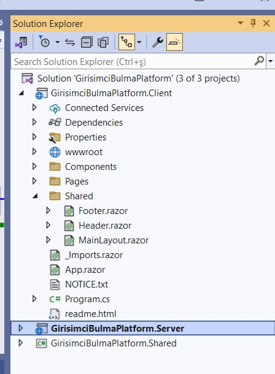
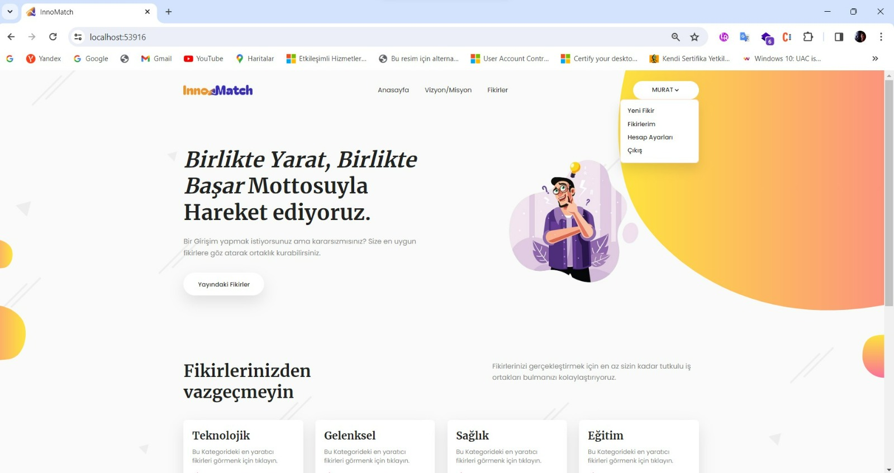
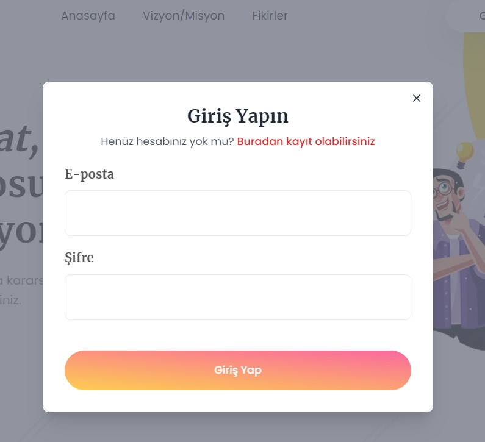
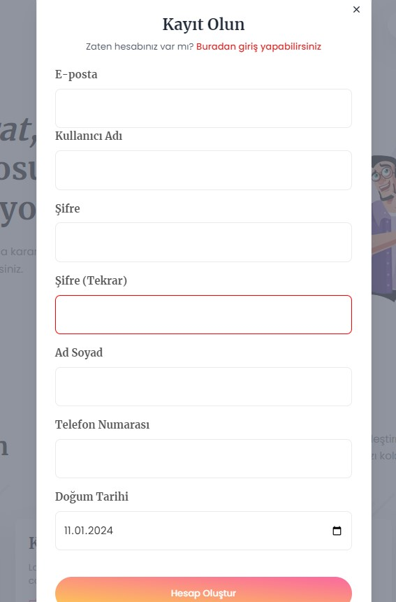
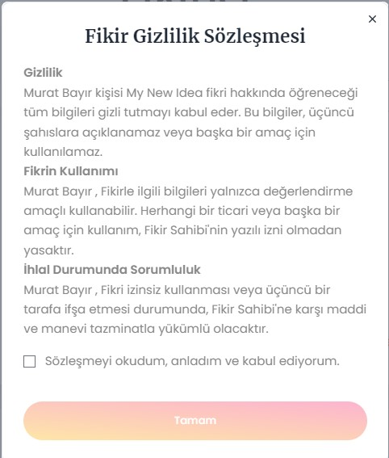
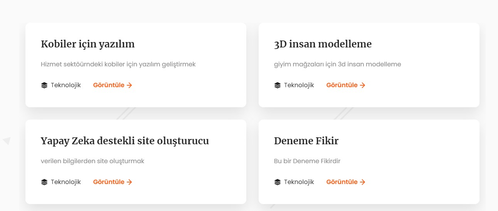

# 🚀 InnoMatch | Full-Stack Blazor WebAssembly & .NET 6 Portfolio Project

> **💡 Proje Hakkında Not:** Bu proje, canlı bir ticari ürün olmayıp; modern web geliştirme teknolojilerini, SPA (Single Page Application) mimarisini ve uçtan uca (Full-Stack) .NET ekosistemini derinlemesine uygulamak amacıyla geliştirilmiş bir **eğitim ve showcase (vitrin) projesidir.**

## 📌 Projenin Amacı ve Senaryosu (Business Logic)
InnoMatch (Girişimci Bulma Platformu), fikri veya projesi olan girişimcilerin çok detay vermeden ilan yayınlayabildiği, ortak arayanları doğru eşleşmeyle hızlandırmayı hedefleyen bir platformdur[cite: 1]. 

Projenin temel iş kuralı **"Gizlilik ve Güven"** üzerine kuruludur[cite: 1]. İlgilenen kullanıcılar, projenin sadece özet bilgilerini görebilir ve ayrıntılı inceleme yapabilmek için sistem üzerinden bir sözleşme onaylamak zorundadır[cite: 1]. Bu senaryo; koşullu arayüz renderlama, form doğrulama ve oturum bazlı yetkilendirme gibi gerçek dünya problemlerinin çözümünü simüle etmektedir.

---

## 🛠️ Teknik Yetkinlikler ve Kullanılan Teknolojiler

Bu projede, kurumsal mimari standartlarına uygun olarak Frontend ve Backend katmanları birbirinden ayrılmış, güçlü bir veri iletişimi kurgulanmıştır.

**Backend (Server Katmanı)[cite: 1]**
*   **ASP.NET Core 6 Web API:** İstemci ile haberleşen RESTful mimarisi.
*   **Entity Framework Core & C#:** Code-first yaklaşımı ile veritabanı modellemesi ve LINQ sorguları[cite: 1].
*   **MSSQL:** İlişkisel veritabanı yönetimi[cite: 1].

**Frontend (Client Katmanı)[cite: 1]**
*   **Blazor WebAssembly:** C# ile tarayıcı tarafında çalışan, JavaScript bağımlılığını azaltan modern SPA mimarisi[cite: 1].
*   **Component Tabanlı Mimari:** Tekrar kullanılabilir (reusable) UI bileşenleri[cite: 1].
*   **DevExpress Blazor Components:** Kurumsal seviyede gelişmiş data grid ve UI bileşenleri entegrasyonu[cite: 1].
*   **Blazored.SessionStorage:** Tarayıcı tarafında güvenli state (durum) ve oturum yönetimi[cite: 1].
*   **HTML, CSS ve JavaScript:** Modern ve responsive arayüz tasarımı[cite: 1].

---

## 🏗️ Proje Mimarisi (N-Tier Architecture)

Uygulama, bağımlılıkları minimize etmek ve sürdürülebilirliği artırmak için 3 ana projeye bölünmüştür[cite: 1]:

*   📂 **GirisimciBulmaPlatform.Server:** Veritabanı işlemlerini yürüten, iş mantığını (business logic) barındıran ve istemciye veri sağlayan ASP.NET Core API katmanı[cite: 1].
*   📂 **GirisimciBulmaPlatform.Client:** Kullanıcı etkileşimlerini yöneten, API ile haberleşen Blazor WebAssembly SPA katmanı[cite: 1].
*   📂 **GirisimciBulmaPlatform.Shared:** İstemci ve Sunucu arasında ortak olarak kullanılan DTO (Data Transfer Object) sınıfları, modeller ve doğrulama kurallarını barındıran ortak kütüphane[cite: 1].

---

## ⚙️ Geliştirilen Modüller ve Öne Çıkan Özellikler[cite: 1]

1.  **Kullanıcı Kayıt ve Giriş Akışı:** Güvenli kimlik doğrulama süreçleri[cite: 1].
2.  **İlan Yönetimi:** CRUD (Create, Read, Update, Delete) operasyonlarını içeren ilan yayımlama ve listeleme ekranları[cite: 1].
3.  **Sözleşme Onay Mekanizması:** İlan detaylarının, yalnızca kullanıcı sözleşmeyi onayladıktan sonra açılmasını sağlayan dinamik yetkilendirme (State Management)[cite: 1].

---

## 📸 Ekran Görüntüleri[cite: 1]

Platformun arayüz tasarımından ve bileşen yapısından örnekler:

*   **Proje Mimarisi (Solution Explorer)**
    
*   **Anasayfa & İlan Listeleme**
    
*   **Giriş Yap & Kayıt Ol Akışları**
    
    
*   **Dinamik Sözleşme Onayı ve Detay Gösterimi**
    
*   **Component Yapısı**
    
